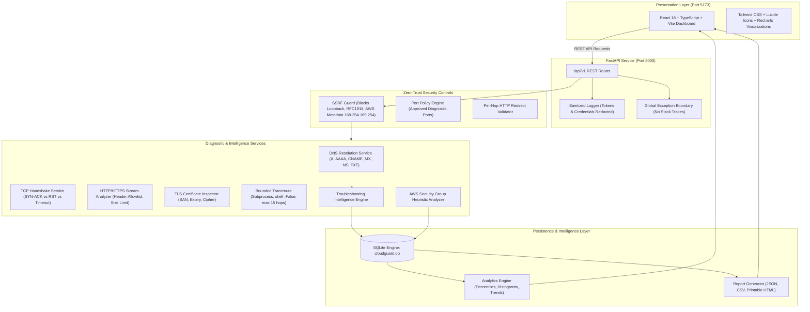

# CloudGuard — Cloud Security & Network Troubleshooting Intelligence Platform

[](https://www.python.org/)
[](https://fastapi.tiangolo.com/)
[](https://react.dev/)
[](https://www.typescriptlang.org/)
[](https://tailwindcss.com/)
[](LICENSE)

**CloudGuard** is a production-style educational platform engineered for Cloud Security Engineers, Network Operations Analysts, and Technical Consultants. Built as a portfolio project for an **Associate Technical Consultant** position at a cloud security leader such as **Skyhigh Security**, **Netskope**, **Zscaler**, or **Cloudflare**, CloudGuard enables structured investigation of network connectivity issues, DNS resolution anomalies, HTTP/HTTPS behaviors, TLS certificate configurations, and AWS cloud security group least-privilege benchmarks.

---

## 1. Executive Overview & Problem Statement

In enterprise cloud security architectures (Secure Access Service Edge, Zero-Trust Network Access, and Secure Web Gateways), technical consultants frequently assist customers with ambiguous connectivity incidents:

- *"Why is our microservice failing to communicate with the cloud database?"*
- *"Is the connection failing at DNS resolution, the TCP transport handshake, or the application layer?"*
- *"Did the firewall drop the packet (timeout) or did the host reject the socket (TCP RST)?"*
- *"Is the customer's AWS security group following the principle of least privilege, or is port 22 or 3306 exposed to 0.0.0.0/0?"*

CloudGuard systematically answers these questions by separating **verifiable diagnostic observations from potential root-cause hypotheses**. Instead of presenting decorative or invented statistics, every chart, metric, and report is computed from real, persisted diagnostic executions.

---

## 2. High-Level System Architecture



---

## 3. Key Feature Modules (9 Functional Pages)

| Module | Purpose & Core Capabilities |
| :--- | :--- |
| **1. Overview Dashboard** | Executive metrics, pass/fail ratios, response time percentiles (p50/p95), runs-over-time trend chart, HTTP status code distribution, and one-click demo data loading. |
| **2. Network Diagnostics** | Composite diagnostic suite running DNS validation, TCP socket connectivity (approved ports), and optional bounded route traceroute with troubleshooting triage findings. |
| **3. HTTP/HTTPS Analyzer** | Web connectivity inspector with redirect chain visualizer (per-hop SSRF validation), response latency meters, allowlisted header presentation, and TLS vs HTTP error separation. |
| **4. DNS Lookup** | Multi-record query module supporting A, AAAA, CNAME, MX, NS, and TXT with resolution duration tracking and an educational DNS troubleshooting guide (NXDOMAIN, timeouts). |
| **5. TLS Inspector** | Read-only X.509 certificate inspector displaying Subject, Issuer, expiration countdown badge, Subject Alternative Names (SANs), negotiated TLS version, and cipher suite. |
| **6. Cloud Security Analyzer** | AWS Security Group least-privilege analyzer with preloaded samples (Overly Permissive, Hardened DB, Public ALB DMZ), file upload, severity rankings (Critical to Info), and remediation guidance. |
| **7. Troubleshooting Reports** | Professional incident report generator with Report UID, scope, evidence, and export options in structured JSON, CSV audit spreadsheets, and standalone printable HTML. |
| **8. Scan History & Analytics** | Audit log with multi-criteria filtering (status, target type), search, pagination, session inspection modal, and delete capabilities. |
| **9. Settings & Portfolio** | Runtime capability check (`/health`), SSRF boundaries status, and portfolio context detailing alignment with cloud security technical consultant roles. |

---

## 4. Technology Stack

### Backend
- **Python 3.11+** (Tested on Python 3.13)
- **FastAPI** — High-performance asynchronous API framework
- **Pydantic V2 & Pydantic-Settings** — Strict request/response typing and boundary validation
- **SQLAlchemy 2.0** — Relational persistence with SQLite
- **HTTPX** — Safe HTTP/HTTPS client with per-hop manual redirect tracking
- **DNSPython** — Comprehensive DNS resolution (A, AAAA, CNAME, MX, NS, TXT)
- **Pytest & Pytest-Asyncio** — Automated unit and integration testing suite

### Frontend
- **React 18** & **TypeScript 5.4**
- **Vite 5** — Rapid modern build tooling
- **Tailwind CSS** — Enterprise dark navy/charcoal styling (`#070b14`)
- **Recharts** — Responsive interactive charts (`AreaChart`, `BarChart`, `PieChart`)
- **Lucide React** — Modern iconography

---

## 5. Security & SSRF Protection Architecture

Security is a primary design requirement of CloudGuard:

1. **SSRF Boundary Enforcement:**
   - Evaluates every target hostname or IP before socket creation.
   - Blocks IPv4 Loopback (`127.0.0.0/8`), RFC 1918 private subnets (`10.0.0.0/8`, `172.16.0.0/12`, `192.168.0.0/16`), Carrier Grade NAT (`100.64.0.0/10`), Link-Local / Cloud Metadata (`169.254.0.0/16` including AWS IMDS `169.254.169.254`), and Multicast (`224.0.0.0/4`).
   - Blocks IPv6 Loopback (`::1/128`), Link-Local (`fe80::/10`), and Unique Local (`fc00::/7`).
2. **DNS Rebinding Protection:**
   - Hostnames are resolved to all candidate IPs; if *any* resolved address is prohibited, the check is aborted immediately.
3. **Per-Hop HTTP Redirect Validation:**
   - Automated client redirection is disabled. Every intermediate hop's `Location` target is re-validated against SSRF policies.
4. **Controlled Port Boundary:**
   - Outbound TCP socket checks are restricted to an approved list of standard service ports (`ALLOWED_PORTS`), preventing weaponization as a port scanner.
5. **Subprocess Hardening:**
   - System route tracing (`tracert` / `traceroute`) executes strictly with `shell=False`, arguments array, bounded hop count (max 15 hops), and a 10-second timeout.
6. **Data Minimization:**
   - Sensitive URL parameters, `Authorization` headers, and cookies are redacted from application logs and report exports.

---

## 6. Windows & Cross-Platform Installation & Local Setup

### Prerequisites
- **Python 3.11+** installed (verified on Python 3.13)
- **Node.js 18+** and **npm** installed (verified on Node v24 / npm 11)
- Windows PowerShell 5.1+ or PowerShell 7+

### Step 1: Clone and Set Up the FastAPI Backend
Open a PowerShell terminal:
```powershell
# Navigate to the project root
cd C:\Users\DELL\.gemini\antigravity\scratch\cloudguard

# Create a virtual environment inside backend
python -m venv backend\venv

# If PowerShell script execution is restricted on your system, enable it for this process:
Set-ExecutionPolicy -ExecutionPolicy RemoteSigned -Scope Process

# Activate the virtual environment
.\backend\venv\Scripts\Activate.ps1

# Upgrade pip and install required dependencies
.\backend\venv\Scripts\pip.exe install -r backend\requirements.txt

# Start the FastAPI backend server (Runs on http://127.0.0.1:8000)
.\backend\venv\Scripts\python.exe -m uvicorn app.main:app --app-dir backend --host 127.0.0.1 --port 8000
```
- **Backend API Base:** `http://127.0.0.1:8000`
- **Interactive OpenAPI (Swagger) Docs:** `http://127.0.0.1:8000/api/v1/docs`
- **ReDoc API Documentation:** `http://127.0.0.1:8000/api/v1/redoc`

### Step 2: Set Up and Run the React Frontend
Open a second PowerShell terminal:
```powershell
# Navigate to the frontend directory
cd C:\Users\DELL\.gemini\antigravity\scratch\cloudguard\frontend

# Install dependencies (React 18, Vite, Tailwind CSS, Recharts, Lucide, Vitest)
npm install

# Start the Vite development server (Runs on http://localhost:5173)
npm run dev
```
- **Frontend Dashboard URL:** `http://localhost:5173/`

---

## 7. Automated Test Suite & Actual Results

### A. Backend Pytest Suite (17 Tests)
Run from the project root:
```powershell
.\backend\venv\Scripts\pytest.exe backend\tests -v
```

**Actual Execution Output:**
```
============================= test session starts =============================
platform win32 -- Python 3.13.7, pytest-8.4.2, pluggy-1.7.0
rootdir: C:\Users\DELL\.gemini\antigravity\scratch\cloudguard
plugins: anyio-4.15.1, asyncio-0.26.0
collected 17 items

backend/tests/test_api.py::test_health_endpoint PASSED                   [  5%]
backend/tests/test_api.py::test_seed_demo_data_and_analytics PASSED      [ 11%]
backend/tests/test_api.py::test_cloud_security_analyze_endpoint PASSED   [ 17%]
backend/tests/test_api.py::test_ssrf_blocked_on_diagnostics PASSED       [ 23%]
backend/tests/test_cloud_sec.py::test_analyze_vulnerable_sg PASSED       [ 29%]
backend/tests/test_cloud_sec.py::test_analyze_hardened_sg PASSED         [ 35%]
backend/tests/test_cloud_sec.py::test_invalid_json PASSED                [ 41%]
backend/tests/test_ssrf.py::test_prohibited_ipv4_addresses PASSED        [ 47%]
backend/tests/test_ssrf.py::test_prohibited_ipv6_addresses PASSED        [ 52%]
backend/tests/test_ssrf.py::test_allowed_public_ips PASSED               [ 58%]
backend/tests/test_ssrf.py::test_validate_target_host_blocking PASSED    [ 64%]
backend/tests/test_ssrf.py::test_validate_target_url PASSED              [ 70%]
backend/tests/test_troubleshooting.py::test_troubleshoot_dns_nxdomain PASSED [ 76%]
backend/tests/test_troubleshooting.py::test_troubleshoot_port_connection_refused PASSED [ 82%]
backend/tests/test_troubleshooting.py::test_troubleshoot_port_timeout PASSED [ 88%]
backend/tests/test_troubleshooting.py::test_troubleshoot_http_status_codes PASSED [ 94%]
backend/tests/test_troubleshooting.py::test_troubleshoot_tls_expired PASSED [100%]

======================== 17 passed, 1 warning in 0.40s ========================
```

### B. Frontend Vitest Suite (6 Tests)
Run from the `frontend` directory:
```powershell
cd frontend
npm test
```

**Actual Execution Output:**
```
 RUN  v1.6.1 C:/Users/DELL/.gemini/antigravity/scratch/cloudguard/frontend

 ✓ src/__tests__/MetricCard.test.tsx   (1 test)  64ms
 ✓ src/__tests__/StatusBadge.test.tsx  (4 tests) 94ms
 ✓ src/__tests__/FindingCard.test.tsx  (1 test)  106ms

 Test Files  3 passed (3)
      Tests  6 passed (6)
   Duration  4.62s
```

### C. Live End-to-End Diagnostic Suite (33 Verifications)
Run against the live running server:
```powershell
.\backend\venv\Scripts\python.exe backend\tests\test_live_suite.py
```
**Result:** `ALL 33/33 LIVE VERIFICATION CHECKS PASSED!`

---

## 8. Safe Demonstration Guide & Verified Sample Inputs

Follow this step-by-step workflow during a portfolio review or technical interview demonstration:

### Step 1: Initialize the Dashboard with Real Historical Data
- Open `http://localhost:5173/` in your browser.
- Click **"Load Demo Scenarios"** in the top navigation bar.
- *What to observe:* The database inserts 6 real diagnostic runs with realistic edge cases (expired TLS certificate, DNS NXDOMAIN, TCP timeout on port 5432, HTTP 403 WAF block, HTTP 502 bad gateway). The Recharts area chart and HTTP status code histogram update immediately from SQLite.

### Step 2: Live Network Diagnostics
- Navigate to **Network Diagnostics** (`/network`).
- **Safe Test Target:** Enter `cloudflare.com` and Port `443` (or use the `cloudflare.com:443` preset button).
- Keep **A / AAAA DNS Resolution** and **TCP Three-Way Handshake** enabled.
- Click **Start Diagnostic**.
- *What to observe:* Real latency measurement (ms), resolved public IP address, verified TCP three-way handshake, and confirmation that no anomalies were detected.
- **Alternative Safe Test Targets:**
  - `example.com:443`
  - `dns.google:53`

### Step 3: Demonstrate SSRF Protection Boundary
- In **Network Diagnostics**, enter `169.254.169.254` (AWS EC2 Instance Metadata IP) or `127.0.0.1`.
- Click **Start Diagnostic**.
- *What to observe:* CloudGuard halts the check before creating sockets and outputs a high-confidence finding:
  > *"Target resolution triggered CloudGuard SSRF security policy for '169.254.169.254'. IPv4 address belongs to restricted network 169.254.0.0/16 (Link-Local / Cloud Metadata)."*

### Step 4: Web Response & Redirect Chain Inspection
- Navigate to **HTTP / HTTPS Analyzer** (`/http`).
- **Safe Test Target (200 OK):** Enter `https://httpbin.org/status/200` & click **Analyze Endpoint**.
- **Safe Test Target (Redirect Chain):** Click the `Redirect Chain (3 hops)` preset (`https://httpbin.org/redirect/3`).
- *What to observe:* Hop-by-hop visualizer displaying each intermediate 302 redirect and Location header, with per-hop SSRF validation.
- **Safe Test Target (WAF 403 Block):** Click `403 Forbidden` (`https://httpbin.org/status/403`).
- *What to observe:* Troubleshooting Engine classifies the 403 status, provides likely explanations (WAF rule, IP restriction), and recommends actionable next steps.

### Step 5: Multi-Record DNS Analysis
- Navigate to **DNS Lookup** (`/dns`).
- **Safe Test Target:** Enter `cloudflare.com` and select `A`, `AAAA`, `MX`, `NS`, `TXT`.
- Click **Execute DNS Query**.
- *What to observe:* Resolved record lists with one-click copy buttons and the educational troubleshooting guide covering NXDOMAIN and resolver timeouts.

### Step 6: TLS X.509 Certificate Inspection
- Navigate to **TLS Inspector** (`/tls`).
- **Safe Test Target:** Enter `cloudflare.com` and port `443`.
- Click **Inspect TLS Certificate**.
- *What to observe:* Valid status badge, days remaining countdown badge, Common Name, Subject Alternative Names (SANs) chips, negotiated TLS protocol version (`TLSv1.3`), and cipher suite.

### Step 7: Cloud Security Least-Privilege Evaluation (AWS)
- Navigate to **Cloud Security (AWS)** (`/cloud-sec`).
- Click the preloaded sample **"Overly Permissive Ingress"**.
- Click **Analyze Configuration**.
- *What to observe:* Real-time static evaluation flagging 2 Critical findings:
  1. *Publicly Accessible SSH Management Port (TCP 22)* open to `0.0.0.0/0`.
  2. *Publicly Accessible Database Port MySQL (Port 3306)* open to `0.0.0.0/0`.
  - Review the evidence snippet and AWS CLI / Terraform remediation instructions.
- Click **"Hardened Private DB"** and run again to observe 0 Critical findings on a compliant configuration.

### Step 8: Standardized Diagnostic Reporting
- Navigate to **Troubleshooting Reports** (`/reports`).
- Select any completed diagnostic run from the dropdown.
- Choose **HTML Report** and click **Export HTML Report**.
- *What to observe:* The report file downloads automatically, a live preview renders in the UI, and clicking **"Print / Save as PDF"** opens a print-ready executive report.

---

## 9. Known Limitations & Responsible-Use Notice

- **Static Security Group Evaluation:** The Cloud Security Analyzer evaluates supplied JSON configurations against least-privilege benchmarks. It does not query live AWS accounts without IAM authorization.
- **Local CA Trust Environment:** TLS verification depends on the Certificate Authorities installed in the scanning machine's operating system certificate store.
- **Resolver-Side View:** DNS diagnostics query the configured recursive resolver; results represent what the client's resolver observes rather than global authoritative propagation.
- **Responsible Use:** CloudGuard is intended strictly for authorized diagnostics, educational research, and internal network troubleshooting. Unauthenticated public deployments must be protected with enterprise SSO, rate limiting, and network firewalls.

---

## 10. Publishing to Your Own GitHub Repository

When ready to publish this project to your GitHub account:

```powershell
# 1. Open PowerShell and navigate to the project root
cd C:\Users\DELL\.gemini\antigravity\scratch\cloudguard

# 2. Initialize Git if not already initialized
git init

# 3. Verify .gitignore is in place (excludes venv, node_modules, .env, *.db)
git status

# 4. Stage all project source files
git add .

# 5. Commit the production codebase
git commit -m "Initial commit: CloudGuard Security & Network Troubleshooting Platform"

# 6. Set the main branch
git branch -M main

# 7. Add your remote GitHub repository URL (replace with your personal repo)
git remote add origin https://github.com/<YOUR_GITHUB_USERNAME>/cloudguard.git

# 8. Push to GitHub
git push -u origin main
```
