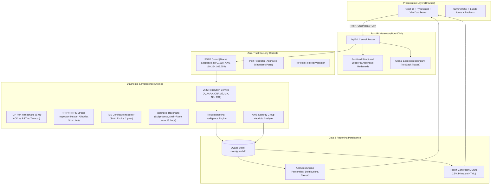
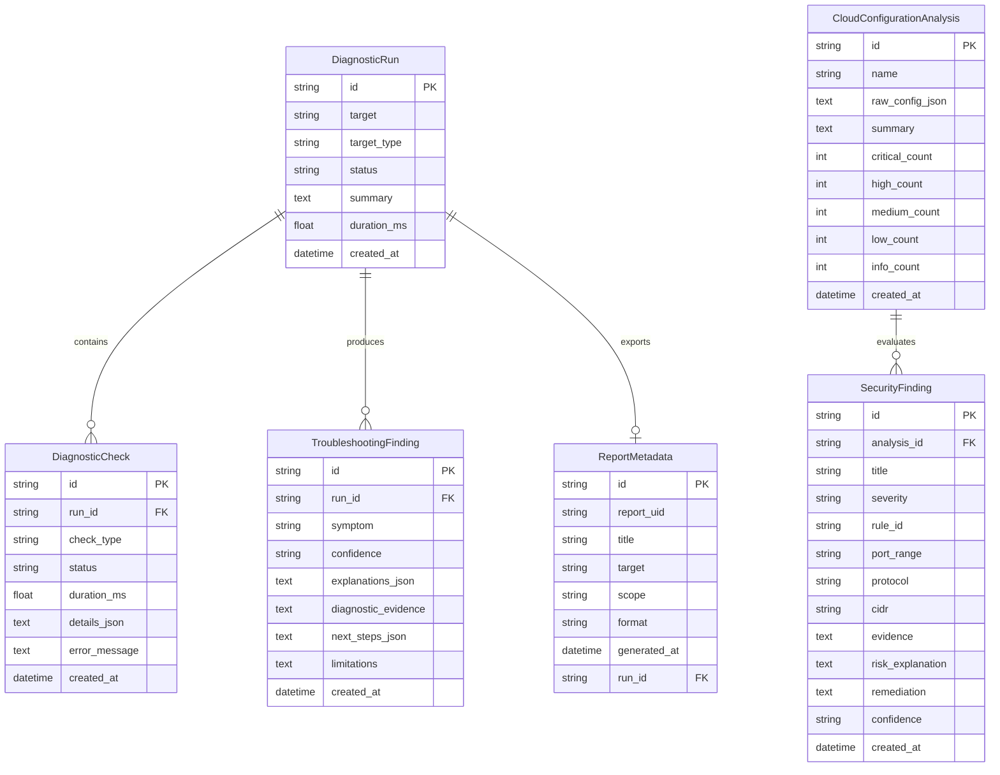

# CloudGuard Architecture & Technical Design

## 1. System Overview

**CloudGuard** is a production-style educational platform designed for Cloud Security Engineers, Network Operations Analysts, and Technical Consultants. It provides safe, controlled diagnostic capabilities for inspecting network connectivity, DNS resolution, HTTP/HTTPS responses, TLS certificate parameters, and AWS Security Group configurations.

The architecture emphasizes:
- **Zero-Trust SSRF Protection:** Every external network attempt is validated against restricted IPv4 and IPv6 CIDR blocks before socket binding.
- **Transparent Troubleshooting Intelligence:** A deterministic, rule-based engine categorizes symptoms, explains potential technical root causes, cites diagnostic evidence, and recommends actionable next steps.
- **Stateless Diagnostics with Persistent History:** Diagnostic runs, individual checks, findings, and cloud evaluations are persisted to SQLite via SQLAlchemy for real analytical aggregation.

---

## 2. High-Level Architecture Diagram

---

## 3. Core Architectural Components

### A. Presentation Layer (Frontend)
- **Framework:** React 18, TypeScript, Vite.
- **Styling:** Tailwind CSS with dark enterprise charcoal theme (`#070b14`).
- **Data Visualizations:** Recharts (`AreaChart`, `BarChart`, `PieChart`, `ResponsiveContainer`).
- **Pages (9 Functional Modules):**
  1. `Overview Dashboard`: Executive metrics, real database aggregations, trend charts, recent sessions.
  2. `Network Diagnostics`: DNS + TCP Port handshake + optional bounded traceroute.
  3. `HTTP/HTTPS Analyzer`: URL inspection, redirect hop visualizer, allowlisted headers, TLS vs HTTP error distinction.
  4. `DNS Lookup`: Multi-record resolution (A, AAAA, CNAME, MX, NS, TXT) with latency tracking and educational guide.
  5. `TLS Inspector`: Subject, Issuer, SANs list, expiration countdown badge, negotiated TLS protocol, and cipher suite.
  6. `Cloud Security Analyzer`: AWS Security Group JSON heuristic analyzer with severity ratings and remediation commands.
  7. `Troubleshooting Reports`: Standardized report generator (JSON, CSV, printable HTML).
  8. `Scan History & Analytics`: Filterable, searchable audit table with pagination and session inspection modal.
  9. `Settings & Portfolio`: Runtime health, SSRF boundary settings, technical consultant career context.

### B. API Gateway & Security Perimeter (Backend)
- **Framework:** FastAPI with Python 3.11+.
- **Validation:** Pydantic V2 schemas for strict request/response typing.
- **SSRF Defense:** Intercepts targets before network operations. Checks against 16 IPv4 restricted CIDRs and 8 IPv6 CIDRs. Blocks AWS metadata (`169.254.169.254`), loopbacks, and private RFC 1918 subnets.
- **Safe Subprocess Execution:** Route traceroute diagnostics invoke system utilities (`tracert` / `traceroute`) without shell invocation (`shell=False`), bounding execution to 15 hops and 10 seconds.
- **Data Redaction:** Sensitive query parameters, `Authorization` headers, and cookie data are stripped from logs and exports.

---

## 4. Database Schema (SQLAlchemy Models)

